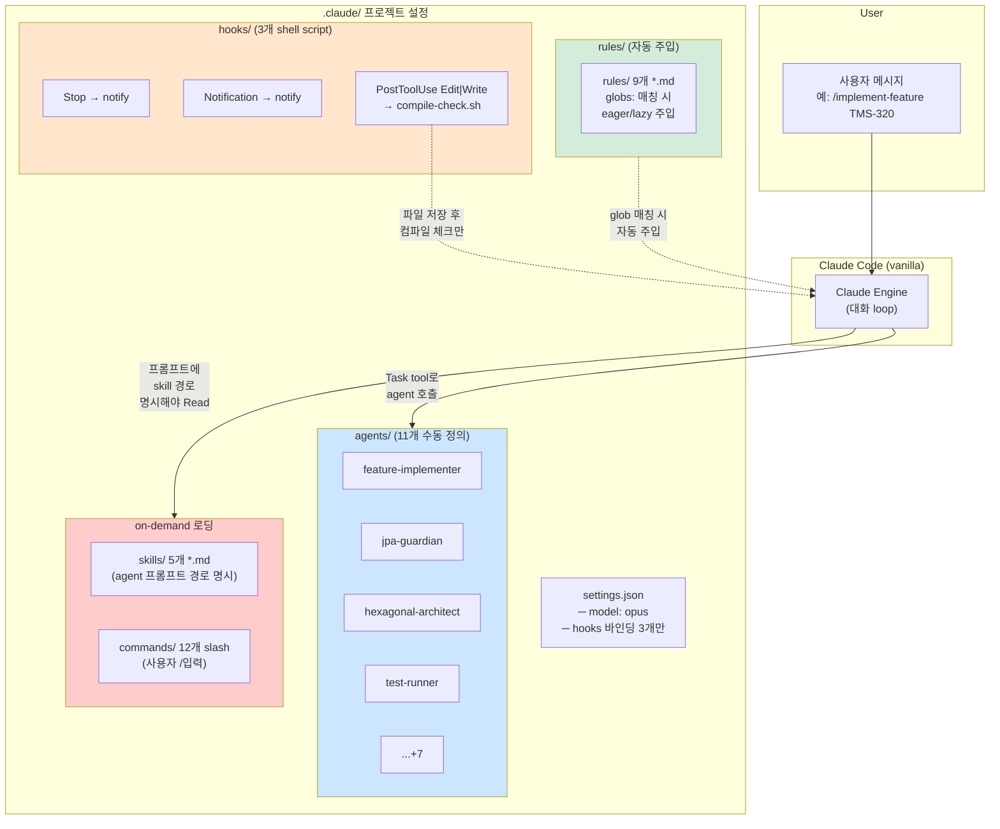
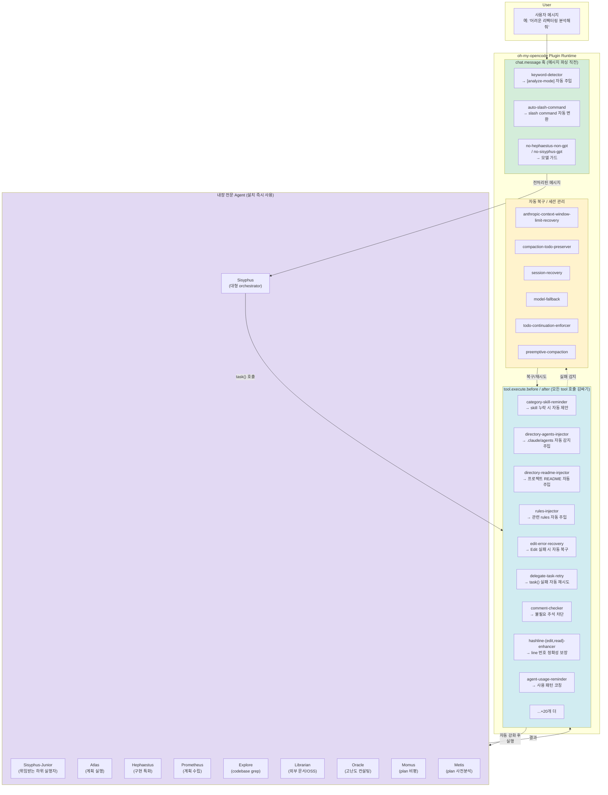

# .claude vs Sisyphus 하네스 아키텍처 비교

> **한 줄 요약**: `.claude`는 **프로젝트마다 수동으로 조립해야 하는 부품 창고**다. OMO는 **재사용 가능한 범용 하네스 인프라(50+ hook, 전문 agent 체계)** — 한 번 설치하면 모든 프로젝트에서 공통 기반으로 동작한다. 그 위에 **자신만의 워크플로우·프롬프트·모델 라우팅을 얹어** 자기 용도로 특화하는 방식이 이 아키텍처의 핵심. `oh-my-qwen`이 바로 그 예시.

---

## 📊 한눈에 보기 — 아키텍처 흐름 비교

### `.claude` (프로젝트 수동 조립) — oaasis-tms-be 사례



**핵심**: hook은 **3개 이벤트만** 바인딩. `rules/`는 `globs:` frontmatter로 eager/lazy 자동 주입됨 (Claude Code 공식 동작). 다만 `skills/`는 **on-demand만** — agent가 프롬프트에서 경로를 명시해야 읽힘. semantic·keyword 기반 주입은 없음.

---

### Sisyphus 하네스 (oh-my-opencode, 완성차형)



**핵심**: 사용자 메시지가 **5단계 파이프라인**(pre-hooks → orchestrator → tool wrappers → agent 전문가 → recovery)을 자동 통과. 각 단계마다 해당 이벤트에 바인딩된 훅이 **알아서** 필요 context를 주입하거나 오류를 복구.

---

## 🆚 핵심 차이 요약

| 차원 | `.claude` | Sisyphus 하네스 |
|---|---|---|
| **Hook 범위** | 3 이벤트 (Stop/Notification/PostToolUse-Edit\|Write) | ~50개 hook, 이벤트 7종+ (chat.message/params, tool.execute.before/after, session.error, ...) |
| **Hook 구현** | Shell script (jq 파싱) | TypeScript, 타입 안전, 상태 저장 가능 |
| **Skill 주입** | **On-demand만** (agent 프롬프트가 경로 명시해야 Read) | **자동** (category-skill-reminder, task(load_skills=[...])으로 명시적·능동적 주입) |
| **Rule 주입** | **자동** (`globs:` frontmatter → eager/lazy) — 단 Read 시에만, Write 시 버그 | **자동** (rules-injector + directory-readme-injector, 추가로 keyword·task-context 기반) |
| **Keyword 모드 감지** | 없음 (/ slash command만 있음) | keyword-detector가 한/영/일/중/베 5언어로 `analyze`/`search`/`ultrawork` 자동 매칭 |
| **오류 복구** | 없음 (사용자가 재시도) | edit-error-recovery, json-error-recovery, delegate-task-retry, context-window-limit-recovery 등 자동 |
| **세션 관리** | 없음 | session-recovery, compaction-{context,todo}-{injector,preserver}, preemptive-compaction |
| **모델 관리** | settings.json 고정 | model-fallback (오류 시 자동 대체 모델), anthropic-effort (난이도에 따라 thinking 조정) |
| **Agent 조합** | 사용자가 Task tool로 수동 호출 | Sisyphus orchestrator가 task/subagent_type/category/load_skills 자동 결정 |
| **Context 누적 관리** | 없음 (단일 긴 대화) | Sisyphus-Junior로 isolated context fan-out (v5 벤치에서 실증됨) |
| **프로젝트 이식성** | `.claude/`를 매번 복제해서 관리 | 한 번 설치, 모든 프로젝트에 적용 |

---

## 🔍 중요한 관찰 — "왜 OMO를 선택하는가?"

**이론적으론 `.claude/`로도 가능.** Sisyphus의 hook을 하나씩 shell/node 스크립트로 재구현하고 각 agent를 수동 정의하면 비슷한 결과를 낼 수 있음.

**실무적으론 불가능:**
1. **50+ hook을 손수 작성**: 각각이 OpenCode의 `tool.execute.before/after` 같은 내부 API와 타입을 맞춰야 함. Claude Code는 shell hook만 제공 — TypeScript plugin 없음
2. **이벤트 coverage 부족**: Claude Code의 hook 포인트는 Stop/Notification/PreToolUse/PostToolUse/UserPromptSubmit/SessionStart/SessionEnd/SubagentStop 뿐. Sisyphus가 쓰는 `chat.message`, `chat.params`, `session.error` 류는 **존재 자체가 없음**
3. **유지보수 비용**: 11개 agent만 정의했는데도 `.claude/agents/*.md`를 계속 손보며 rule/skill 참조를 붙여야 함. 프로젝트마다 이 작업을 반복해야 함

### 이 아키텍처의 진짜 가치: 범용 인프라 + 자기만의 커스터마이징 층

> **OMO = 재사용 가능한 범용 하네스 인프라**: LLM 행동을 통제 가능한 범위 안으로 끌어오는 50+ hook, 오류 복구, 세션 관리, 전문 agent 체계 — **이 공통 기반을 매번 재구현하지 않는다**.
>
> **사용자가 할 일 = 그 위에 자기 워크플로우를 얹는 것**: 모델 라우팅(`oh-my-openagent.json`), 자기 도메인 skill, 프로젝트별 prompt 커스터마이징, 워크플로우별 command. 공통 하네스는 OMO가 이미 해결해놓았기 때문에 **사용자는 자기 문제에 특화된 층만 신경쓰면 됨**.

`oh-my-qwen`이 바로 이 패턴의 사례:
- **OMO가 제공하는 것**: Sisyphus 프롬프트, Todo Continuation, Boulder State, Background dispatch, 모델 라우팅 스키마
- **`oh-my-qwen`이 얹은 것**: Qwen3.6-Plus provider 등록, DashScope `preserve_thinking` 파라미터 주입, Qwen 모델별 역할 매핑(Oracle=qwen3-max, Explore=qwen3-coder-next)

하네스 엔지니어링의 본질은 **"LLM이라는 야생마에게 마구를 채워 원하는 방향으로 이끄는 통제 설계"** — 그리고 그 통제 장치를 **프로젝트마다 새로 만들지 않고 재사용 가능한 인프라로 만들어, 사용자는 자기 문제에 해당하는 커스터마이징만 책임지게 하는 것**.

---

## 🧩 이번 벤치마크(v5)와의 연결

[[v5 실행 검증]]에서 Sisyphus가 Vanilla를 이긴 원인은 **context isolation** 하나였음. 이 isolation은 Sisyphus 하네스 중 어느 부분이 담당하는가?

| 기능 | 어디서 옴 |
|---|---|
| 각 subagent가 독립 conversation | 내장 Sisyphus-Junior agent 시스템 + `delegate-task` tool |
| task() 실패 시 재시도 | `delegate-task-retry` hook |
| context 너무 커지면 자동 압축 | `preemptive-compaction` + `compaction-{context,todo}-preserver` |
| 태스크별 skill 자동 로드 | `category-skill-reminder` + `directory-agents-injector` |
| parallel fan-out 보조 | Sisyphus agent prompt + `task()` 도구의 `run_in_background` |

`.claude`로 이 조합을 재현하려면:
- agent 정의 파일마다 "너는 독립 context야" 명시 (수동)
- retry 로직을 agent 프롬프트에 써야 (Claude는 hook 없음)
- compaction은 Claude Code가 자체 지원하지만 프롬프트 기반이라 덜 세밀
- skill 주입은 매 turn마다 프롬프트에 명시해야 함

**결과**: `.claude`로도 흉내는 가능하지만 **프로젝트마다** 같은 인프라를 재구현해야 함. OMO는 이 공통 층을 **한 번 정의된 재사용 가능한 라이브러리**로 제공하므로, 사용자는 자기 도메인의 agent/skill/모델 라우팅만 얹으면 됨.

---

## 📚 참고 경로

```
/Users/wonjunchoi/IdeaProjects/oaasis-tms-be/opencode/.claude/
├── agents/        11개 (jpa-guardian, feature-implementer, ...)
├── hooks/         3개 shell script
├── rules/         9개 *.md (`globs:` 기반 자동 주입)
├── skills/        5개 *.md (수동 참조용)
├── commands/      12개 slash command
└── settings.json  hook 바인딩 3개 이벤트

~/.local/share/mise/installs/node/24.11.0/lib/node_modules/oh-my-opencode/dist/
├── hooks/         ~50개 TypeScript hook
├── agents/
│   └── builtin-agents/  sisyphus/atlas/hephaestus/...
├── tools/delegate-task/
└── features/context-injector
```

---

## 🔗 관련 노트
- [[Sisyphus 벤치마크 전체 여정]] — 마스터
- [[v5 실행 검증]] — isolated context가 왜 품질 차이를 만들었나
- [[나만의 Oh My Qwen 구축해서 하네스 구축하기]] — 발표자료. 하네스 엔지니어링 철학
