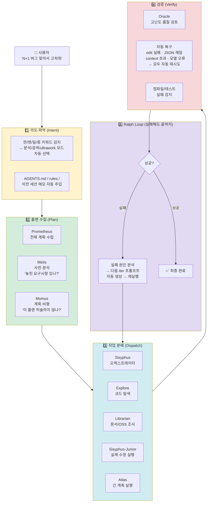
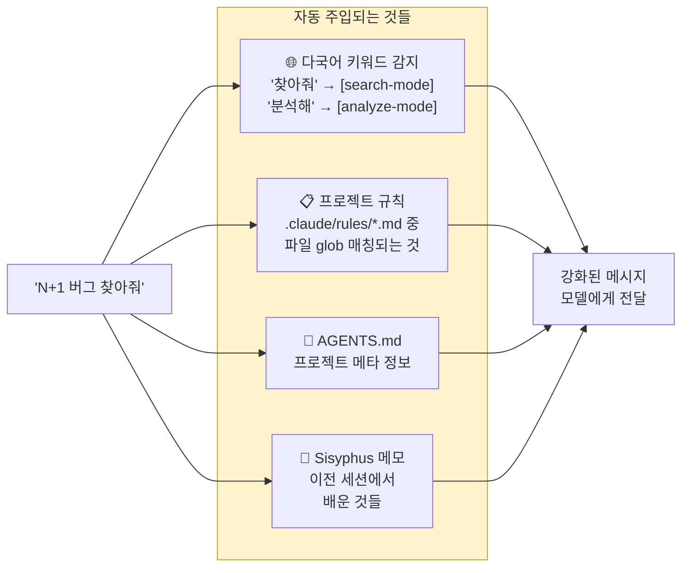
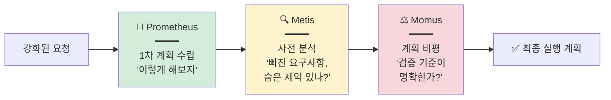
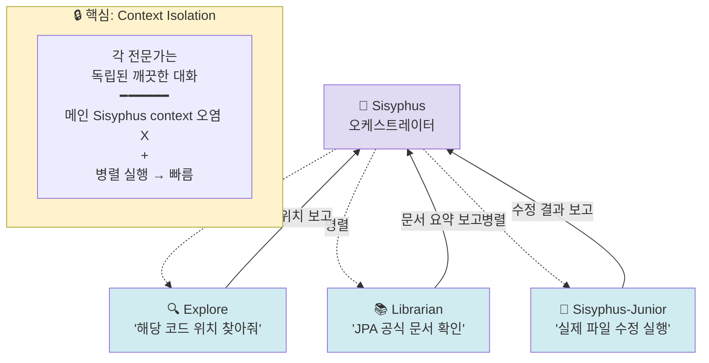
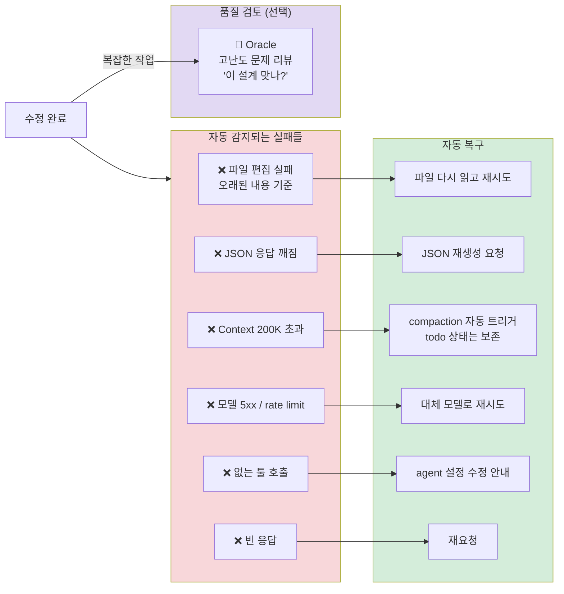
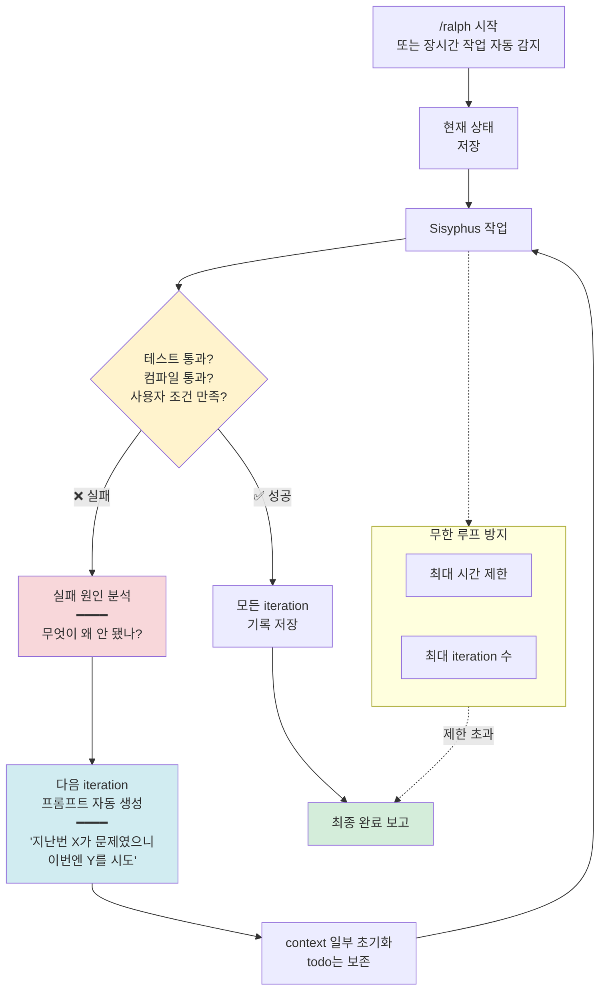

# oh-my-opencode 기능·작업흐름 다이어그램

> **핵심 메시지**: OMO는 "AI에게 일을 시키는 전체 흐름"을 5단계 — **의도 파악 → 플랜 → 작업 분배 → 검증 → 루프(Ralph)** — 로 파이프라인화한 제품.

---

## 🎬 전체 작업 흐름 (사람이 읽는 관점)

---

## 1️⃣ 의도 파악 — "사용자가 뭘 원하는지 자동으로 해석"

**하는 일**: 사용자 메시지를 그대로 모델에 던지지 않고, **한 번 가공**해서 필요한 컨텍스트를 얹음.

**효과**:
- 사용자는 *"이 프로젝트는 Spring Boot고 헥사고날이야..."* 반복 입력 불필요
- 한국어로 말해도 자동으로 AI 친화적인 프롬프트로 변환

---

## 2️⃣ 플랜 수립 — "계획부터 검증하고 시작"

**하는 일**: 바로 코드 수정 들어가지 않고, **플래너 에이전트 3명**이 계획의 품질을 교차 검증.

**왜 3명?**:
- Prometheus가 짠 계획에는 **blind spot**이 있음
- Metis가 *"이 요건 놓쳤는데?"* 지적
- Momus가 *"검증 방법이 구체적이지 않다"* 비평
- 3명 합의 후에야 실행 단계로 넘어감

**.claude/와 다른 점**: `.claude`는 보통 1명(feature-implementer)이 계획+실행 다 함 → blind spot 걸러지지 않음.

---

## 3️⃣ 작업 분배 — "1명이 다 하지 말고 전문가에게"

**하는 일**: 메인 에이전트(Sisyphus)가 **작업을 쪼개서 전문가에게 위임**, 병렬 실행.

**효과** (v5 벤치에서 실증):
- Vanilla(혼자 다 함): 한 세션에 모든 탐색+수정 누적 → 디테일 놓침
- Sisyphus(위임): 각 전문가가 자기 일만 집중 → 품질 ↑, 토큰 ↓

---

## 4️⃣ 검증 — "실패하면 자동으로 복구"

**하는 일**: 수정 결과를 검증하고, **예상 가능한 실패들은 자동으로 처리**.

**.claude/와 결정적 차이**: `.claude`는 compile-check 1개만 있음. 나머지 실패는 사용자가 수동으로 "다시 해줘" 입력.

---

## 5️⃣ Ralph Loop — "성공할 때까지 포기 안 함"

**하는 일**: 한 번 실패했다고 멈추지 않고, **완료 조건 만족까지 자동 반복**.

**사용 예시**:
- 테스트 3개 실패 → 자동 수정 → 2개 실패 → 자동 재수정 → 0개 실패 ✅
- 컴파일 에러 20개 → 자동 수정 → 5개 → 0개 ✅
- 사용자는 최초 명령 한 번만 하고 커피 타러 감

---

## 📊 한 장 요약 — 5단계 vs `.claude/`

| 단계 | OMO가 주는 것 | `.claude`로 직접 구현 |
|---|---|---|
| **1️⃣ 의도 파악** | 다국어 키워드 감지, 자동 context 주입, 메모 기억 | rules 자동 주입은 가능, 나머지는 불가 |
| **2️⃣ 플랜 수립** | Prometheus+Metis+Momus 3명 교차 검증 | feature-implementer 혼자 계획+실행 |
| **3️⃣ 작업 분배** | Sisyphus+전문 에이전트 10+, 병렬 fan-out | Task tool로 수동 위임 (병렬 제어 없음) |
| **4️⃣ 검증** | 6종류 자동 복구 + Oracle 리뷰 | compile-check 1개만 |
| **5️⃣ Ralph 루프** | 성공까지 자동 반복, todo 보존 | 없음 (사용자 수동 재실행) |

---

## 💬 발표에서 할 말

> **"`.claude/`는 '부품 창고'고, OMO는 '완성된 작업실'입니다.**
>
> 부품 창고에는 좋은 망치·톱·못이 다 있어요. 근데 의자 만들려면 제가 조립 순서를 짜야 해요. 실수하면 제가 다시 짜고.
>
> OMO는 다릅니다. *'의자 만들어줘'* 한마디면 — 계획 짜는 사람이 계획 짜고, 비평가가 검토하고, 목수가 톱질하고, 품질 검사관이 확인하고, 안 되면 다시 시도까지 — 5단계가 자동으로 돕니다.
>
> 그래서 저처럼 바쁜 엔지니어한테는 OMO가 더 맞는 겁니다."

---

## 🔗 관련 노트

- [[claude vs Sisyphus 하네스 아키텍처 비교]] — `.claude` vs OMO 구조 비교
- [[v5 실행 검증]] — 3️⃣ 작업 분배의 context isolation이 품질 차이 만든 실증
- [[발표 자료 정리 - 간단하게 하네스 구축하기]] — 이 다이어그램 §3에서 활용