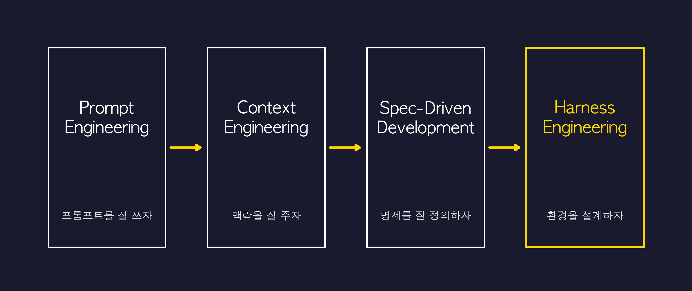
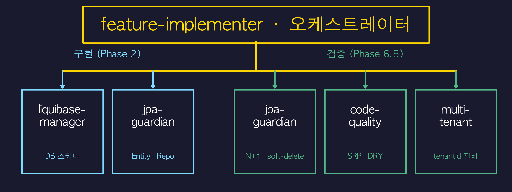
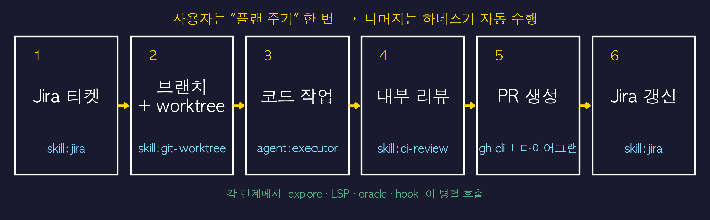
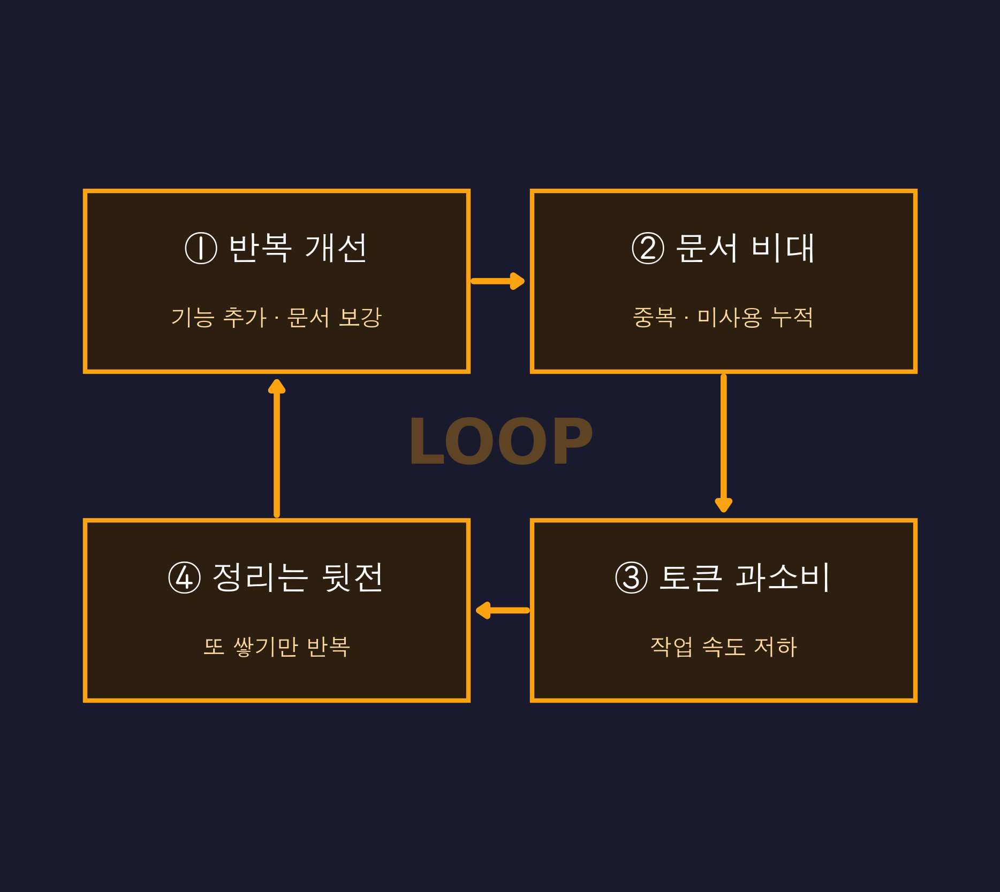

<!-- _class: lead -->

# 나만의 Oh My Qwen<br/>구축해서 하네스 구축하기


발표자 — 최원준

---

# 1. 하네스 엔지니어링

---

## 트렌드의 변화




---

## 하네스 엔지니어링 = 환경 설계

AI 에게 작업을 할 수 있는 다음과 같은 환경 제공

<div class="columns">
<div>

- **맥락** (Context)
- **워크플로우** (Workflow)
- **툴** (Tools)

</div>
<div>

- **검증** (Verification)
- **반복 개선** (Loop)

</div>
</div>

---

## 실제 사례 — askUserQuestion

**문제**: AI가 모호한 요구사항에서 **혼자 추측**하고 잘못된 방향으로 질주
**해결**: 선택지를 강제로 제시하는 툴 → 사용자 의사결정을 워크플로우에 구조화

```
 [AI가 불확실한 상황을 감지]
      │
      ▼
 ┌─ Option A: Redis 사용 (빠름, 설정 필요)
 ├─ Option B: In-memory cache (단순, 휘발성)
 └─ Custom: 직접 입력
      │
      ▼
 [사용자 선택 후에만 진행]
```

**효과**: 임의 판단 차단 → 잘못된 방향으로 10분 낭비하는 일 방지

---

## 실제 사례 — oh-my-pi의 `hashline`

**문제**: AI가 파일 수정할 때 diff 포맷(apply_patch) 문법을 정확히 재현 못함
**해결**: 라인마다 짧은 해시 앵커 → **좌표로 참조** (텍스트 재현 불필요)

```
 11#VK| function hello() {
 22#XJ|   return "world";
 33#MB| }
```

모델은 `LINE#HASH` 좌표로 edit → 파일이 바뀌면 해시 mismatch → 거부

| 모델                   | Before (apply_patch) | After (hashline) |
| -------------------- | -------- | ----------------- |
| **Grok Code Fast 1** | 6.7%     | **68.3%** (10× ↑) |


---

# 2. 용어가 등장하기 이전

---
## 하네스 엔지니어링 용어가 등장하기 전

- "하네스 엔지니어링"이라는 용어 자체가 없던 시절
- AI를 잘 쓰기 위한 **체계적 방법론이 정형화되지 않음**
- 각 CLI 코딩 에이전트마다 설정 방식이 다름
- 결국 **공식 문서 보면서 각자 알아서 구현**하는 수밖에 없었음


---

## DIY의 시절

CLI 코딩 에이전트 위에 하네스 엔지니어링의 구성요소를 **직접 구축**

<div class="columns">
<div>

- **Agents** — 병렬 전문가 정의
- **Skills** — 비결정성 보완 지식
- **Commands** — 워크플로우 트리거
- **Rules** — 제약 조건

</div>
<div>

- **Hooks** — 자동 검증
- **Tracking** — 실행 추적
- **Loop** — 반복 실행
- **Session** — 세션 재개

</div>
</div>

---

## Agents — 병렬 수행을 위한 전문 페르소나

"각 에이전트를 **독립된 context**에서 돌리면 서로 오염 없이 병렬 실행 가능"



> 그 외: hexagonal-architect · spring-boot-expert · srp-enforcer · test-runner  +3


---

## Skills — AI의 비결정성을 보완하는 공유 지식

| 스킬 | 방지 대상 | 실제 사례 |
|---|---|---|
| **testing-standards** | 필드 누락 | 11개 필드 중 8개 누락 → 테스트 강제 |
| **hexagonal-architecture** | 계층 오염 | 도메인에 `@Entity` 섞임 → 차단 |


- 여러 에이전트가 **동일 스킬을 참조** → 일관된 판단 기준
- AI가 "한 번 잘 됨" ≠ "항상 잘 됨" → **스킬로 기준을 고정**

---

## Commands — 목적별 워크플로우 트리거

| 카테고리 | 대표 명령어 | 하는 일 |
|---|---|---|
| **티켓/기획** | `/create-ticket` | 코드베이스 분석 → Jira 티켓 자동 생성 |
| **구현** | `/implement-feature` | 8개 에이전트 + 테스트 + 커밋 일괄 오케스트레이션 |
| **리뷰/검증** | `/pre-pr` | 아키텍처·보안·쿼리·테스트 전 영역 자동 검사 |
| **커밋** | `/smart-commit` | staged 변경 분석 → conventional commit 메시지 생성 |


> 명령어 하나 = **Agent + Skill + Tool 체인**을 트리거

---

## Rules & Hooks

<div class="columns">
<div>

### Rules — 제약 조건

- **worktree** — main 편집 금지
- **review-checklist** — 8대 실수
- **rest-controller** — HTTP 전용
- **destructive-ops** — 삭제 확인

</div>
<div>

### Hooks — 비결정성 보정 자동화

- **compile-check.sh** (post-edit)
  수정마다 컴파일 체크 → 에러 조기 발견
- **notify.sh** (on-notify)
  개입 필요 시 macOS 알림
- **stop-notify.sh** (on-stop)
  작업 완료 알림

</div>
</div>


---

## Execution Tracking — 실행 추적

"에이전트가 일을 했다고 **주장**하는데, 정말 했는지 어떻게 아는가?"

정의한 sub-agent를 호출하게 시키면 **기본적으로 블랙박스**:

- 실행 후 부모에게 돌아오는 건 **텍스트 요약뿐**
- **skill 로드 여부는 어떤 방식으로도 리포트 안 됨**
- 누가 뭘 했는지 **기본 UI로는 추적 불가**

→ AI의 "했습니다"를 **믿을 수 없으니** 증거를 남기는 구조를 직접 만듦

**추적 대상**: Phase 진행률 (커밋 해시 검증) / Agent 호출 여부 / Skill 참조 여부

---

## 반복 실행 — "통과할 때까지"

테스트·컴파일이 통과할 때까지 AI가 **스스로 반복**하게 만들고 싶음

Agent 설정에 직접 명시:

```
"Fix issues → re-invoke → proceed only when all pass."
"DO NOT PROCEED until ALL agents pass."
"Maximum 2 review cycles."
```

- 설정 길어질수록 AI가 **지시를 잊음**
- 반복 조건을 agent마다 매번 명시
- 세션 끊기면 반복 상태 유실

---

## Session Save — 세션 재개

"7단계 작업 중간에 세션이 끊기면 → **어디까지 했는지 모른다**"

- 세션 끊기면 context 전부 사라짐 → **처음부터 다시**
- 이전 세션에서 배운 것(패턴, 결정사항)이 날아감

### Resume Protocol (DIY)

```
 progress/TMS-481.md 읽기
    → Phase별 commit hash를 git log에서 검증
    → hash 있음: DONE 유지 / hash 없음: PENDING으로 되돌림
    → 첫 번째 미완료 Phase부터 재개
```

**한계**: 전부 **파일 기반 수동 관리** — 파일 안 만들면 끝


---

# 3. 용어 등장 이후

---

## Sisyphus

> "인간이 매일 바위를 굴리듯, 당신의 에이전트도 **반복해서 굴러야 한다**."

`Oh My Openagent` (이하 **OMO**)가 등장:

- **LSP · Tool · Hook · Agent** 가 기본 내장
- `ulw` 루프, 전문 페르소나, 세션 복구 — **전부 박스 안에**

---

## 내장 하네스 아키텍처

**5단계 자동 파이프라인**

1. **chat.message 훅** — keyword-detector(5언어), auto-slash-command, 모델 가드
2. **Orchestrator (Sisyphus)** — task · subagent · skill 자동 결정
3. **tool.execute 훅** — rules-injector, category-skill-reminder, edit-error-recovery, hashline-enhancer, ...+20
4. **내장 전문 Agent** — Sisyphus / Sisyphus-Junior / Atlas / Hephaestus / Prometheus / Explore / Librarian / Oracle / Momus / Metis
5. **자동 복구 / 세션 관리** — context-window-recovery, session-recovery, model-fallback, preemptive-compaction


---

## 병렬 실행이 기본값

<div class="columns">
<div>

### CLI 코딩 에이전트

```
사용자: "이거 병렬로 해줘"
AI:     Task tool 수동 위임
        병렬 제어 없음
        단일 긴 context 오염
```

</div>
<div>

### OMO (opencode)

```
Sisyphus가 알아서 fan-out
→ explore 3개 동시 fire
→ 각각 isolated context
→ 결과만 수집, 메인 오염 X
```

</div>
</div>

**내장 병렬화 계층**:

```
 autopilot (전체 라이프사이클 자동)
   └── ralph (PRD 기반 반복 + 검증 루프)
         └── ultrawork (독립 태스크 병렬 실행 엔진)
               └── run_in_background (OS 레벨 비동기)
```

---

## 실행 추적: 파일 기반 DIY → SQLite 내장

<div class="columns">
<div>

### DIY (execution-tracking skill)

```
/progress/TMS-481.md
├── Phase 4: DONE (commit: a3f2e1c)
├── Phase 5: PENDING  ← 여기서 재개
└── [수동 기록, 수동 검증]
```

- Agent 사용 여부 **수동 집계**
- Skill 호출 여부 **수동 기록**
- AI가 기록 안 하면 **추적 불가**

</div>
<div>

### opencode 내장

```
.omc/state/agent-replay-{session}.jsonl
├── agent_start/stop (자동)
├── skill_activated (자동)
├── tool_start/end + duration_ms
└── bottleneck 자동 감지
```

- `trace_timeline` — 이벤트 조회
- `trace_summary` — 통계 집계
- 13+ 이벤트 타입 자동 기록
- SQLite 내장

</div>
</div>

---

## 반복 실행: 프롬프트 명시 → ralph 내장

<div class="columns">
<div>

### DIY (Agent 설정에 명시)

```
"Fix issues → re-invoke
 → proceed only when all pass"

"Maximum 2 review cycles"
```

- context 길어지면 **지시를 잊음**
- agent마다 반복 조건 직접 작성
- 세션 끊기면 반복 상태 유실

</div>
<div>

### OMO (ralph / ulw 내장)

```
 ralph loop:
 작업 → 검증 → 실패 → 자동 수정 → 검증
                                    │
              성공할 때까지 반복 ◄────┘
      
 todo 보존 → 끊겨도 이어서
```

- `/ralph-loop` 명령어로 반복 실행
- 성공 조건 만족까지 자동
- 중간 상태 영속화 (todo 보존)

</div>
</div>


---

## 돌이켜보니 — 바퀴를 다시 발명하고 있었다

Ch2에서 제가 **밤새 고민하며 직접 만들었던 것들**:

| 내가 만든 것                                     | 실제로 이미 있던 것                                                       |
| ------------------------------------------- | ----------------------------------------------------------------- |
| execution-tracking skill (파일 기반 로그 + 세션 확인) | opencode 내장 **SQLite trace** (`trace_timeline` / `trace_summary`) |
| "Fix → re-invoke" 프롬프트 지시                   | **`ralph`** 루프 내장                                                 |
| Task tool 수동 fan-out                        | Sisyphus **자동 병렬** (ulw)                                          |
| Agent 설정에 적는 반복 조건                          | 성공 조건까지 **자동 재시도**                                                |

> 대부분 **이미 잘 관리되는 오픈소스**가 해결하고 있었고, OMO로 갈아타니 손쉽게 해결됐습니다.


---

# 4. Qwen 하네스 엔지니어링 테스트

---
## Qwen 하네스 엔지니어링 실험 설계

**가설**: Qwen 위에 Sisyphus orchestration을 얹으면 얼마나 달라지는가?

| 조건 | Vanilla | Sisyphus |
|---|---|---|
| Context | 단일, 순차 | 병렬 fan-out, isolated |
| Skill 주입 | O (공정) | O (공정) |
| 코드베이스 | oaasis-tms-be | oaasis-tms-be |
| 태스크 | H1~H5, HARD1~3 | H1~H5, HARD1~3 |

**측정**: wall-clock · 토큰 · 정답률 (자동 채점)

> **공정성 원칙**: 둘 다 동일한 `AGENTS.md` + task-specific skill 주입.
> 유일한 차이는 **orchestration (parallel + isolated context)**.

---

## 벤치마크 ① — Qwen3.6-plus (탐색/경량 수정형)

### 5개 태스크 (H1 ~ H5)

| # | 태스크 요약 | 유형 |
|---|---|---|
| **H1** | `Order.getFirstShipment()` 호출 사이트 28곳 찾기 | 전수 탐색 |
| **H2** | N+1 쿼리 원인 file:line 지목 + 수정안 | 진단 |
| **H3** | 헥사 아키텍처 신규 UseCase 스켈레톤 생성 | 생성 |
| **H4** | MapStruct `Impl` 파일 분석 후 unused 판정 | 함정 회피 |
| **H5** | `DeleteRouteService` Long 메서드 제거 결정 + 증거 | 판정 |

---

## 벤치마크 ① — 효율성 지표 (공정 조건)

| 지표 | Vanilla | **Sisyphus** | 비율 |
|---|---:|---:|---:|
| **Wall-clock** | 883.7 s | **319.4 s** | **0.36×** (64% 단축) |
| **Total tokens** | 6,526,369 | **2,691,626** | **0.41×** (59% 절감) |
| Input tokens | 6,492,858 | 2,664,065 | 0.41× |
| Output tokens | 33,511 | 27,561 | 0.82× |
| Tool calls | 111 | 138 | 1.24× |


---

## 벤치마크 ① — 품질 지표

| 태스크 | 검증 기준 | Vanilla | Sisyphus |
|---|---|:-:|:-:|
| H1 | 28개 호출 사이트 전수 발견 | **28/28** ✅ | **28/28** ✅ |
| H4 | MapStruct Impl 함정 회피 | ✅ | ✅ |
| H4 | unused 결론 (정답) | ✅ | ✅ |
| H5 | Long 메서드 제거 판정 (정답) | ✅ | ✅ |
| H5 | caller=0 증거 제시 | ✅ | ✅ |


---

## 벤치마크 ② — Qwen3-coder-plus (컴파일·테스트 검증형)

### 3개 태스크 (HARD1 ~ HARD3)

| # | 태스크 | 난이도 요소 |
|---|---|---|
| **HARD1** | `saveAll` batch 경로의 shipment id/location 보존 버그 | MapStruct 상호작용 + regression test |
| **HARD2** | `GeospatialService` 도로명 없을 때 fallback | 간단한 edge case |
| **HARD3** | `DeleteRouteUseCase` **cross-module refactor** | interface + service + adapter + tests 동시 수정 |


---

## 벤치마크 ② — 결과

| 태스크 | Vanilla | **Sisyphus** |
|---|:-:|:-:|
| HARD1 (MapStruct 버그) | ❌ 0/3 compile 실패 | ❌ 0/3 compile 실패 |
| HARD2 (fallback) | ✅ 3/3 | ✅ 3/3 |
| **HARD3 (cross-module refactor)** | ❌ **0/3** compile 실패 | ✅ **3/3** |
| **TOTAL** | **3/9 (33%)** | **6/9 (67%)** |

> **Sisyphus가 2배 점수**. HARD3에서 결정적 차이.
> Vanilla는 `RouteV3ApiImpl.java` 수정 중 `RouteStatusDto` **import 누락** → compile 실패.
> Sisyphus는 3개 파일 모두 성공 (이름 변경 반영, import 유지).

---

## 왜 HARD3에서 차이가 났나?

<div class="columns">
<div>

### Vanilla

```
HARD1 → HARD2 → HARD3
   (단일 누적 context)
         │
         ▼
  복잡해진 context에서
  HARD3 도달 → detail 놓침
  (import 관리 실패)
```

</div>
<div>

### Sisyphus

```
HARD3 전용 isolated context
         │
    ┌────┼────┐
    ▼    ▼    ▼
AGENTS skill skill
 .md   hex   spring
       test  boot
         │
         ▼
  원본 파일 신중히 읽고
  import 까지 세심히 관리
```

</div>
</div>

> **orchestration을 통한 context engineering을 통해 목표 달성**.

---

## 종합 — 벤치마크가 말하는 것

```
 쉬운 태스크 (HARD2, H1~H5 일부)
      ├─► orchestration 없어도 OK (Qwen이 이미 강함)
      └─► 가치 = 효율성 (wall-clock 64% ↓, 토큰 59% ↓)

 어려운 태스크 (HARD3: cross-module refactor)
      ├─► orchestration이 품질에서 실질 이득
      └─► 2× 점수 차이 (3/9 → 6/9)

 초고난도 (HARD1: 외부 라이브러리 미묘한 동작)
      └─► orchestration도 못 품 (모델·하네스 공통 한계)
```


---

# 5. 나만의 하네스 엔지니어링 구축

---

## 내 업무의 "표준 절차"를 AI에게



- **전체 흐름**은 `AGENTS.md` 에 정의
- **Jira / review** 같은 무거운 부분은 **별도 skill** 로 분리


---

## AI가 "이 프로젝트를 아는 상태"로 시작하게

```
 내 프로젝트 루트/
  │
  ├── AGENTS.md              ← 프로젝트 구조·진입점
  │
  ├── docs/architecture.md   ← 깊은 내용·탐색 가이드
  │
  ├── rules/                 ← 경로·파일 기반 자동 로드
  │
  └── skills/                ← 복잡한 작업 단위 분리
```

---

## rule vs skill — 역할 분담

| | **rule** | **skill** |
|---|---|---|
| **언제 로드?** | 특정 파일·경로 매칭 시 자동 | 작업 의도 매칭 시 자동 |
| **크기** | 짧은 규칙 (수십 줄) | 복잡한 워크플로우 (수백 줄) |
| **예시** | `src/api/*.ts` → REST 규칙 | `jira` 티켓 생성 전체 플로우 |
| **토큰 절약** | 필요한 파일에서만 호출 | 필요한 작업에서만 호출 |

**참고할 만한 오픈소스:**

- [safishamsi/graphify](https://github.com/safishamsi/graphify) — 코드베이스를 **지식 그래프**로 (토큰 71.5× 절감)
- [muratcankoylan/Agent-Skills-for-Context-Engineering](https://github.com/muratcankoylan/Agent-Skills-for-Context-Engineering) — 컨텍스트 엔지니어링 skill 모음 (14종)


---

## AI는 비결정적 — 한 번으로 끝나지 않는다

```
  실행 → 관측 → 비교 → 개선 → 실행 → ...
    │      │      │      │
    │      │      │      └─ AGENTS.md / rule / skill 수정
    │      │      └──────── 지시대로 수행됐나?
    │      └─────────────── 토큰·시간·정확도
    └─────────────────────── 실제 작업
```

- **지시한 대로 수행됐는지** 지속 관측
	- 이를 위해 부가적으로 어떠한 도구나 skill을 사용했는지 추적 필요
- **목표 기준**을 만족하는지 주기적 체크
- "한 번 잘 됐다"로 끝내지 말 것

---

## AI slop — 정리 없는 반복 개선의 악순환

<div class="columns">
<div>



</div>
<div>

**점검 체크리스트**

- ☐ 중복된 문서가 있는가?
- ☐ 작업별로 **적합한 문서**가 호출되고 있는가?
- ☐ 더 이상 쓰이지 않는 rule · skill 이 있는가?
- ☐ 한 파일이 너무 커져 오히려 느려지진 않나?

</div>
</div>

---

## 결국 도달하는 곳 — "딸깍"

반복되는 부분을 조금씩 추가하고 개선하다 보면

- 따로 지시하지 않아도 **알아서 해당 사항이 달성됨**
- 처음엔 매번 직접 시키던 것 → 하네스가 **자동으로 수행**

---

<!-- _class: lead -->

# 감사합니다 🗿

**하네스 엔지니어링, 한 번 시작해보세요.**

---

<!-- _class: lead -->

# Q&A

**Thank you!**
