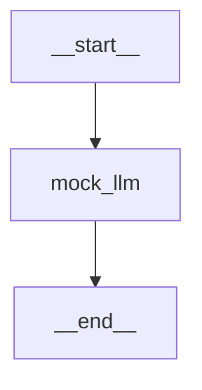

# Ch01. Overview · Install · Quickstart

> 출처: [overview](https://docs.langchain.com/oss/python/langgraph/overview) · [install](https://docs.langchain.com/oss/python/langgraph/install) · [quickstart](https://docs.langchain.com/oss/python/langgraph/quickstart) · [thinking-in-langgraph](https://docs.langchain.com/oss/python/langgraph/thinking-in-langgraph)

## 1. LangGraph가 제공하는 것

| 기능 | 의미 |
|---|---|
| 결정적 + 에이전트 단계 혼합 | 하드코딩 로직과 LLM 판단을 한 그래프에 배치 |
| Persistence | 실패해도 이전 상태에서 재개 |
| Human-in-the-loop | 실행 중 상태를 검사·수정 |
| Memory | 세션 내 working memory + 세션 간 long-term memory |
| LangSmith 디버깅 | 실행 경로 시각화, 상태 전이 추적 |
| 배포 | 상태 있는 워크플로용 프로덕션 인프라 |

## 2. Hello World

[`hello_world.py`](./hello_world.py) — LLM 없이 그래프 골격만 확인.

```python
graph = StateGraph(MessagesState)      # 1) 상태 스키마로 빌더 생성
graph.add_node(mock_llm)               # 2) 노드 = state를 받아 부분 업데이트를 반환하는 함수
graph.add_edge(START, "mock_llm")      # 3) 엣지로 흐름 연결
graph.add_edge("mock_llm", END)
graph = graph.compile()                # 4) compile → 실행 가능한 Runnable
graph.invoke({"messages": [...]})
```

실행 결과 (2026-09-30, langgraph 1.2.12):

```
human: hi!
   ai: hello world
```

관찰 포인트:
- 노드는 `messages` **전체가 아니라 추가분만** 반환했는데 결과엔 human + ai 둘 다 남는다 → `MessagesState`의 `messages` 채널에 `add_messages` reducer가 붙어 있기 때문. (Ch02에서 reducer 상세)
- dict로 넣은 메시지가 `HumanMessage` / `AIMessage` 객체로 변환된다 (`m.type`이 `human`/`ai`).
- `graph.get_graph().draw_mermaid()`로 구조를 Mermaid로 뽑을 수 있다.



## 3. 다음 할 일

- [ ] Quickstart 따라 실제 LLM + tool 붙인 계산기 에이전트 작성 (`uv add langchain-anthropic`)
- [ ] "Thinking in LangGraph" 읽고 설계 절차(노드 쪼개기 → 상태 정의 → 엣지) 정리
