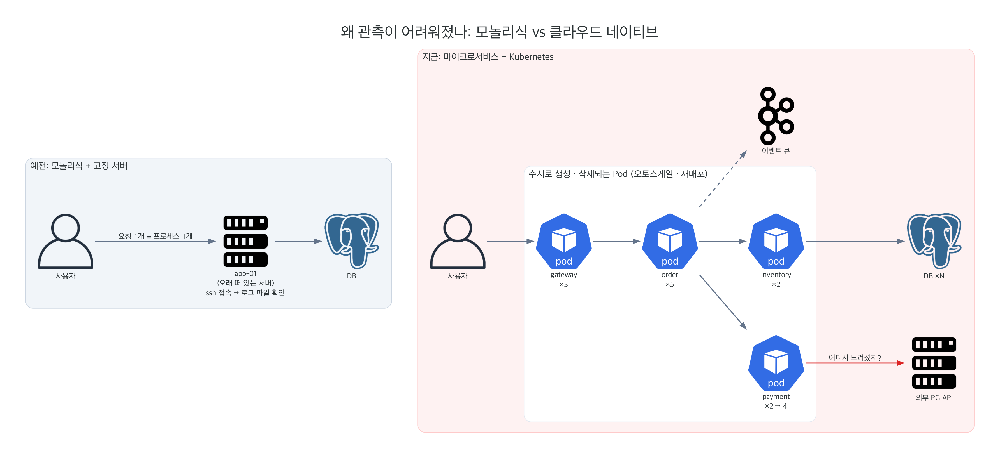
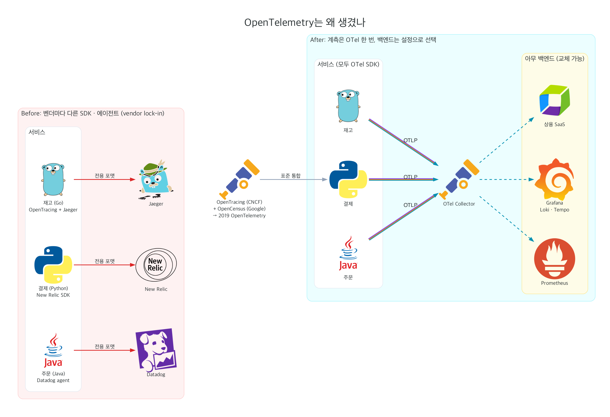
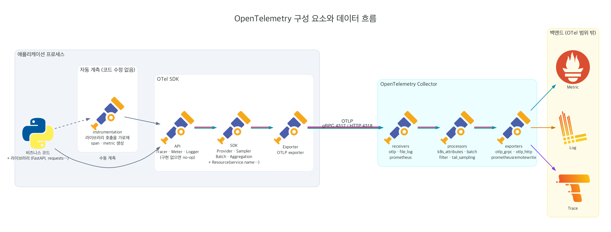
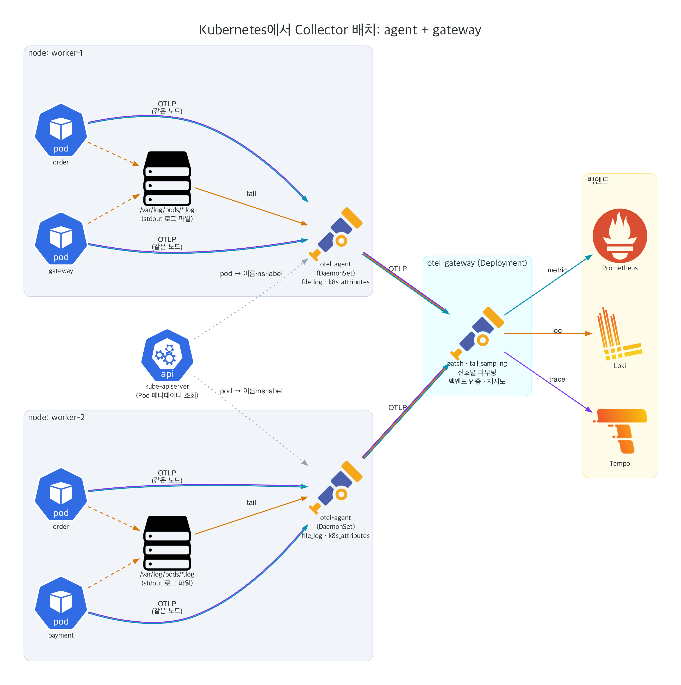
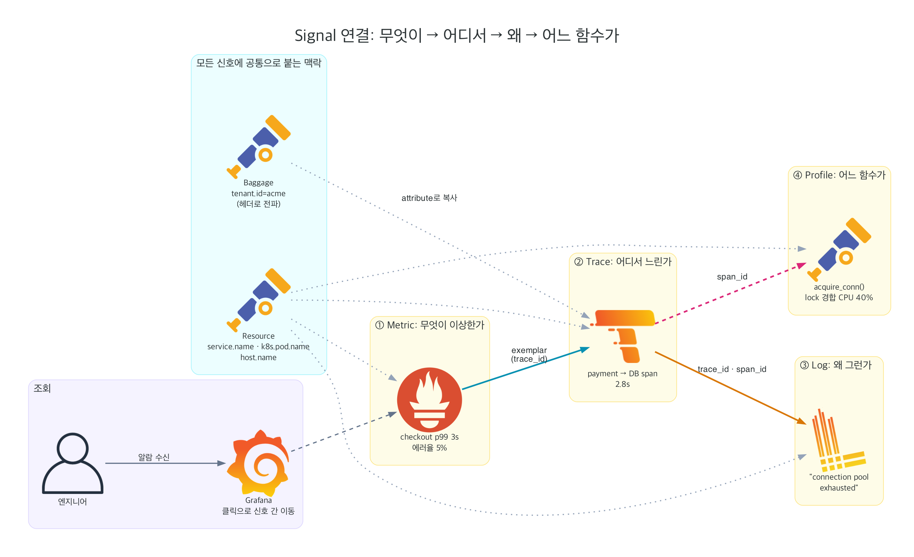
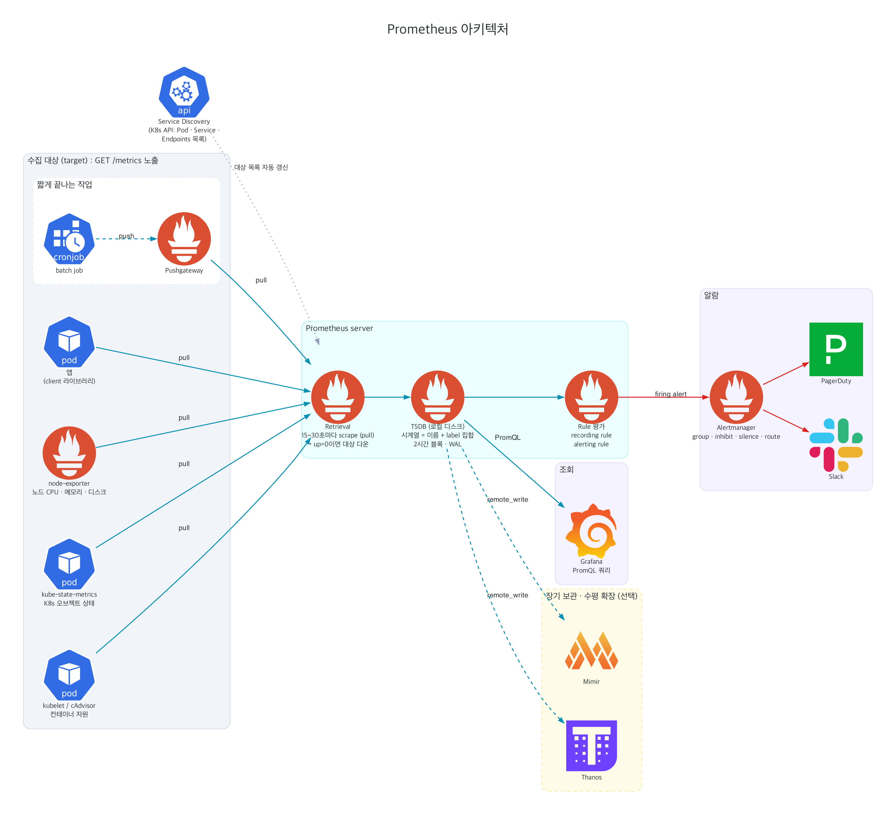
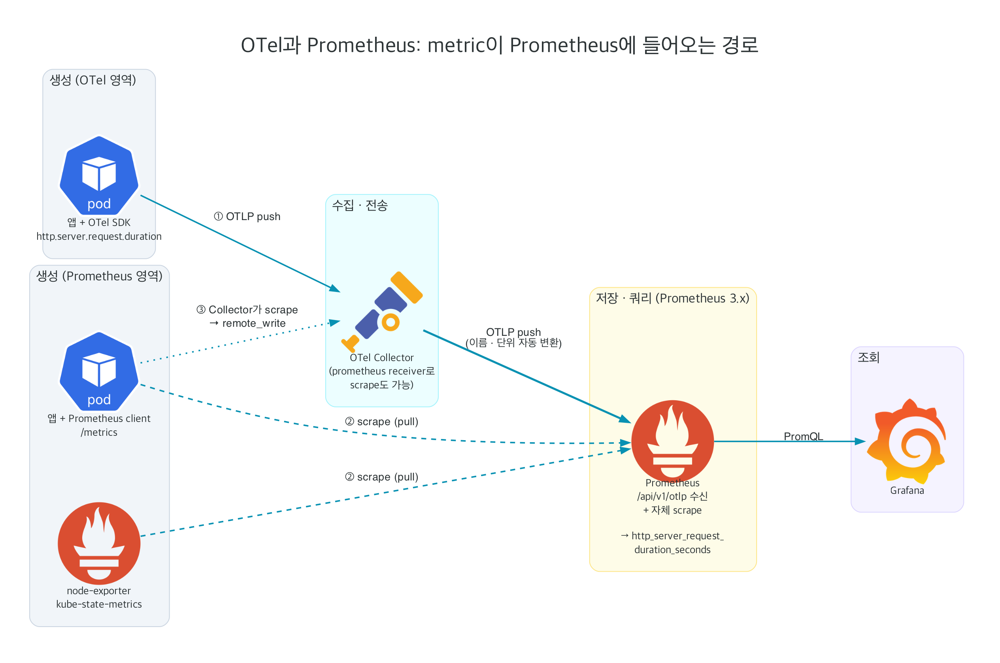

# OTel · Prometheus 다이어그램으로 따라가기

> 다이어그램 소스: [`diagrams/`](diagrams/) (Python `diagrams` 라이브러리, `python3 0X_*.py`로 재생성)
> 실측 데이터: [`../lab/`](../lab/README.md) kind 클러스터에서 2026-10-28에 직접 조회한 값
> 신호별 상세 정의는 [README.md](README.md) 참고

---

## 1. 배경: 왜 관측이 어려워졌나



| 예전 (모놀리식) | 지금 (클라우드 네이티브) |
|---|---|
| 서버 몇 대가 오래 떠 있다 | Pod가 오토스케일·재배포로 수시로 생기고 사라진다 |
| 요청 1개 = 프로세스 1개 | 요청 1개가 서비스 여러 개 · 큐 · 외부 API를 거친다 |
| ssh 접속해서 로그 파일을 보면 된다 | 들어갈 서버가 이미 없거나 어느 Pod였는지 모른다 |
| 장애 패턴을 대부분 예상할 수 있다 | 처음 보는 조합의 장애가 계속 생긴다 (unknown unknowns) |

- **Monitoring**: 알려진 문제를 감시한다. "CPU 80% 넘으면 알람"
- **Observability**: 예상하지 못한 질문도 바깥으로 나온 신호(telemetry)만으로 답할 수 있게 한다. "왜 특정 고객사 결제만 느리지?"

"외부에서 내부를 관측한다"는 표현은 제어 이론의 observability 정의(출력만으로 내부 상태를 추론할 수 있는 정도)에서 왔다.

---

## 2. OpenTelemetry는 왜 생겼나



**Before**
- 벤더마다 전용 SDK · 에이전트 · 데이터 포맷이 있었다. 벤더를 바꾸면 계측 코드도 다시 짜야 했다 (vendor lock-in).
- 오픈소스 표준도 OpenTracing(CNCF)과 OpenCensus(Google)로 나뉘어 있었다.

**After (2019, 두 프로젝트 통합 → OpenTelemetry)**
- 계측은 OTel로 한 번만 한다. 데이터는 표준 프로토콜 OTLP로 나간다.
- 어느 백엔드로 보낼지는 Collector 설정이 정한다. 백엔드를 바꿔도 앱 코드는 그대로다.

핵심 원칙 두 가지:
1. 데이터는 사용자가 소유한다 (벤더 중립)
2. API · 규칙 하나만 익히면 된다 (언어 · 신호 무관)

OTel은 **데이터를 만들고 옮기는 표준**이다. 저장소나 UI는 포함하지 않는다.

---

## 3. OTel 구성 요소와 데이터 흐름



| 구성 요소 | 역할 |
|---|---|
| **API** | span · metric · log를 만드는 인터페이스. 구현이 없으면 no-op이라 라이브러리가 안전하게 의존할 수 있다 |
| **SDK** | API의 실제 구현. 샘플링 · 배치 · 집계, Resource(`service.name` 등) 부착 |
| **Instrumentation** | 자동 계측은 FastAPI · requests 같은 라이브러리 호출을 가로채 span을 만든다. 수동 계측은 비즈니스 로직에 직접 추가한다 |
| **Exporter** | SDK가 모은 데이터를 OTLP로 내보낸다 |
| **OTLP** | 신호 전송 표준 프로토콜. gRPC 4317 / HTTP 4318 |
| **Collector** | receiver(수신) → processor(가공) → exporter(송신) 파이프라인 |
| **Semantic Conventions** | `http.response.status_code` 같은 attribute 이름 규칙. 이름이 같아야 신호끼리 연결된다 |

---

## 4. Kubernetes에서 Collector 배치



| | agent (DaemonSet) | gateway (Deployment) |
|---|---|---|
| 위치 | 노드마다 1개 | 클러스터 중앙에 1개 이상 |
| 하는 일 | 같은 노드 Pod의 OTLP 수신, `/var/log/pods/*.log` tail, `k8s_attributes`로 Pod 이름 · namespace · label 부착 | batch, tail sampling, 신호별 백엔드 라우팅, 인증 · 재시도 |
| 왜 이렇게 나누나 | 노드 로컬 정보(로그 파일, Pod IP)는 노드에서만 얻을 수 있다 | 트레이스 전체를 봐야 하는 tail sampling은 한곳에 모여야 한다. 백엔드 연결 정보도 한곳에서 관리한다 |

### lab 실측: 실제로 떠 있는 Collector

```
observability  otel-agent-agent-5hpcg        Running   (worker)
observability  otel-agent-agent-tqvd7        Running   (worker2)
observability  otel-gateway-d555cd578-pplph  Running
```

---

## 5. Signal 연결: 무엇이 → 어디서 → 왜 → 어느 함수가



| 연결 수단 | 연결 방향 |
|---|---|
| **Exemplar** | Metric 히스토그램 bucket에 실제 샘플의 `trace_id`를 붙인다 → Trace로 이동 |
| **trace_id · span_id** | Trace ↔ Log, Trace ↔ Profile |
| **Resource** | 모든 신호에 `service.name`, `k8s.pod.name`을 붙여 같은 대상으로 필터 |
| **Baggage** | `tenant.id` 같은 비즈니스 맥락을 헤더로 전파 (자동으로 attribute가 되지는 않음) |

### lab 실측: 요청 하나를 Metric → Trace → Log로 추적

데모 앱은 `gateway → order → payment` 구조이고, payment가 일정 확률로 실패하도록 만들어져 있다.

**① Metric: 무엇이 이상한가** (PromQL)

```promql
sum by (job) (rate(http_server_request_duration_seconds_count{http_response_status_code=~"5.."}[2m]))
  / sum by (job) (rate(http_server_request_duration_seconds_count[2m]))
```
```
demo/gateway  0.068
demo/order    0.068
demo/payment  0.068      → 세 서비스 모두 에러율 약 6.8%
```

**② Exemplar: Metric에서 Trace로**

payment의 지연 히스토그램 bucket에 붙은 exemplar:
```
le=0.005  {trace_id: be6b98dd935c84623faea3d39b4b9ccb, span_id: 318c46784283face}
```

**③ Trace: 어디서 실패했나** (Tempo, TraceQL `{ status = error }`)

```
gateway  GET /checkout          35.6ms  ERROR
gateway  POST                   33.8ms  ERROR
order    POST /orders           31.8ms  ERROR
order    reserve_inventory      25.3ms           ← 시간은 여기서 대부분 씀
order    POST                    3.2ms  ERROR
payment  POST /pay               1.4ms  ERROR    ← 에러의 시작점
```
에러가 payment에서 시작해 order, gateway로 거슬러 올라간 것이 보인다. 세 서비스 에러율이 같았던 이유다.

**④ Log: 왜 실패했나** (Loki, 같은 `trace_id`로 필터)

```
payment  ERROR    "payment gateway timeout"   span_id=318c46784283face
order    WARNING  "payment failed"            status=500
gateway  ERROR    "checkout failed"           status=502
```
exemplar의 `span_id`(`318c46…`)와 payment ERROR 로그의 `span_id`가 같다. Metric 점 하나에서 원인 로그 한 줄까지 ID만으로 도착했다.

---

## 6. Prometheus 아키텍처



**Metric을 수집 · 저장 · 조회하는 시계열 DB이자 모니터링 시스템.** CNCF에서 Kubernetes 다음으로 졸업한 두 번째 프로젝트다.

### 데이터 모델
```
http_requests_total{service="payment", method="POST", status="500"}  →  (t1, 1027), (t2, 1031) …
```
- 시계열 = metric 이름 + label 집합. label 값 조합마다 별도 시계열이 된다.
- `user_id` 같은 고유값을 label로 넣으면 시계열이 폭증해 메모리가 터진다 (**cardinality 폭발**).

### Pull 모델
- 대상이 `/metrics`에 현재 값을 노출하고, Prometheus가 15~30초마다 가져간다 (scrape).
- **Service Discovery**로 K8s API에서 Pod 목록을 받아 수집 대상을 자동 갱신한다. Pod가 계속 바뀌는 환경에 맞다.
- 장점: 대상이 죽으면 `up == 0`으로 바로 보인다. 앱은 Prometheus 위치를 몰라도 된다.
- 예외: 금방 끝나는 batch job은 Pushgateway에 push하거나 OTLP로 보낸다.

### 구성 요소
| 구성 | 역할 |
|---|---|
| Exporter | 스스로 `/metrics`를 못 내는 대상을 metric으로 변환 (node-exporter, kube-state-metrics, cAdvisor) |
| TSDB | 로컬 디스크 저장. 2시간 단위 블록 + WAL |
| Rule | recording rule(무거운 쿼리 미리 계산), alerting rule(조건 만족 시 알람) |
| Alertmanager | 알람 grouping · inhibition · silence · routing → Slack, PagerDuty |
| Mimir / Thanos | 단일 노드 한계를 넘는 장기 보관 · 수평 확장 (remote_write) |

### Metric 타입
| 타입 | 의미 | 쿼리 |
|---|---|---|
| Counter | 누적 증가값 | `rate()`로 초당 증가율. 재시작 시 0으로 돌아가는 것도 보정 |
| Gauge | 현재 값 | 그대로 |
| Histogram | bucket별 개수 | `histogram_quantile()`로 p95 · p99 |
| Summary | 클라이언트가 계산한 분위수 | 인스턴스 간 합산 불가 → 요즘은 Histogram 권장 |

### lab 실측: Prometheus가 scrape 중인 대상

```promql
count by (job) (up == 1)
```
```
kubelet 9 · node-exporter 3 · kube-state-metrics 1 · apiserver 1 · coredns 2
otel-agent 2 · otel-gateway 1 · grafana 1 · prometheus 2 · operator 1
```
현재 head 시계열 수: **45,507개** (`prometheus_tsdb_head_series`). 3노드 실습 클러스터 하나로도 이 정도가 나온다.

```promql
# 서비스별 p95 (Tempo가 span에서 만들어 remote_write한 metric)
histogram_quantile(0.95, sum by (le, service) (rate(traces_spanmetrics_latency_bucket[2m])))
```
```
gateway 0.25s · order 0.227s · payment 0.148s
```

---

## 7. OTel과 Prometheus의 관계



| | OpenTelemetry | Prometheus |
|---|---|---|
| 역할 | 신호 **생성 · 전송** 표준 | Metric **저장 · 조회** 백엔드 |
| 신호 | Metric · Trace · Log · Profile | Metric만 |
| 수집 방식 | 주로 push (OTLP) | 주로 pull (scrape) |

Metric이 Prometheus에 들어오는 경로는 세 가지다.
1. **OTLP push**: OTel SDK → Collector → Prometheus `/api/v1/otlp`. Prometheus 3.x가 직접 받는다. 이름은 자동 변환된다 (`http.server.request.duration` → `http_server_request_duration_seconds`).
2. **scrape**: Prometheus가 `/metrics`를 직접 pull. node-exporter, kube-state-metrics 같은 인프라 metric.
3. **Collector가 scrape**: Collector의 prometheus receiver가 대신 긁어 remote_write. 기존 exporter를 OTel 파이프라인으로 합치고 싶을 때.

lab은 1번(앱 metric)과 2번(인프라 metric)을 나눠 쓴다. 같은 대상을 두 경로로 중복 수집하지 않기 위해서다.

### lab 실측: 경로 1 (OTLP)로 들어온 앱 metric

```promql
sum by (job, http_response_status_code) (rate(http_server_request_duration_seconds_count[1m]))
```
```
demo/gateway  200  1.2 req/s   502  0.089 req/s
demo/order    200  1.2 req/s   502  0.089 req/s
demo/payment  200  1.2 req/s   500  0.089 req/s
```
`job` 값이 `demo/gateway`인 것은 OTel Resource의 `service.namespace/service.name`이 Prometheus label로 변환된 결과다.

---

## 직접 재현하기

```bash
cd study/observability/lab && ./up.sh
kubectl --context kind-observability -n observability port-forward svc/grafana 3000:80   # http://localhost:3000 admin/admin
```
Grafana → Explore에서 위 PromQL을 실행하고, 그래프의 exemplar 점 → Tempo trace → "Logs for this span" 순서로 클릭하면 5장의 흐름을 UI로 따라갈 수 있다.
